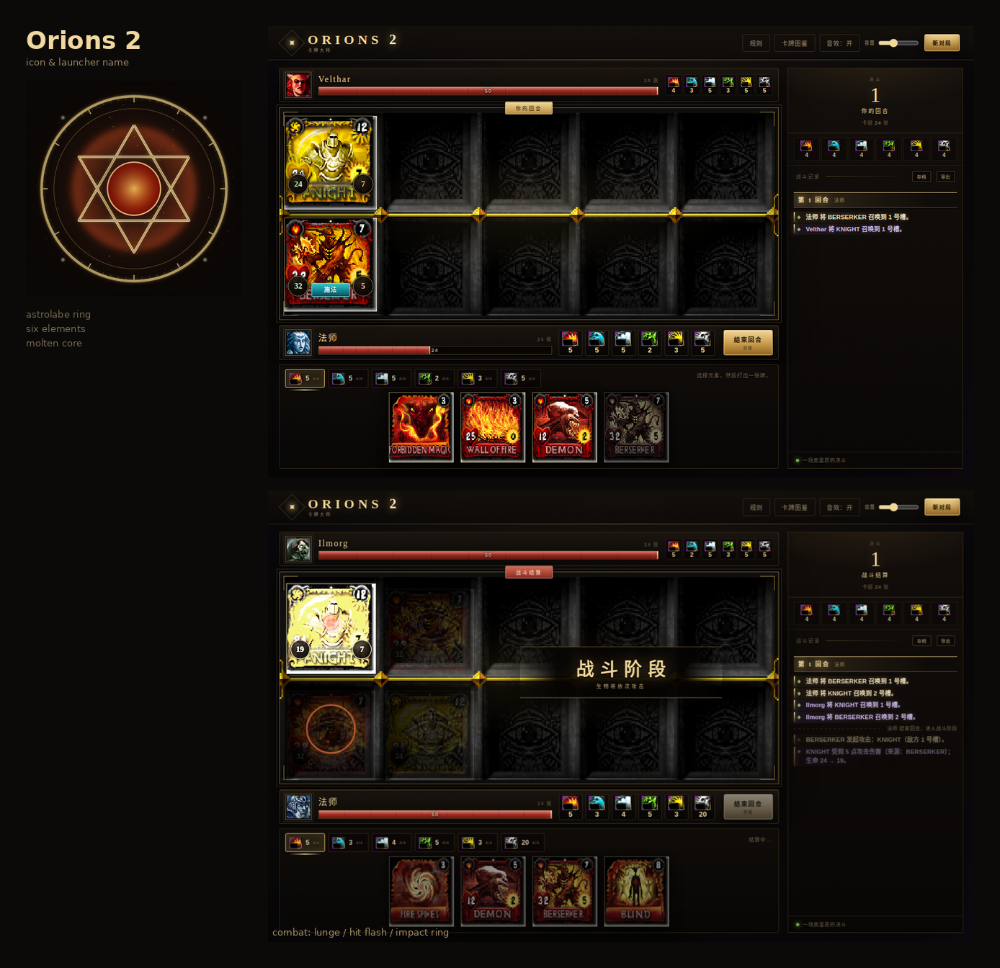
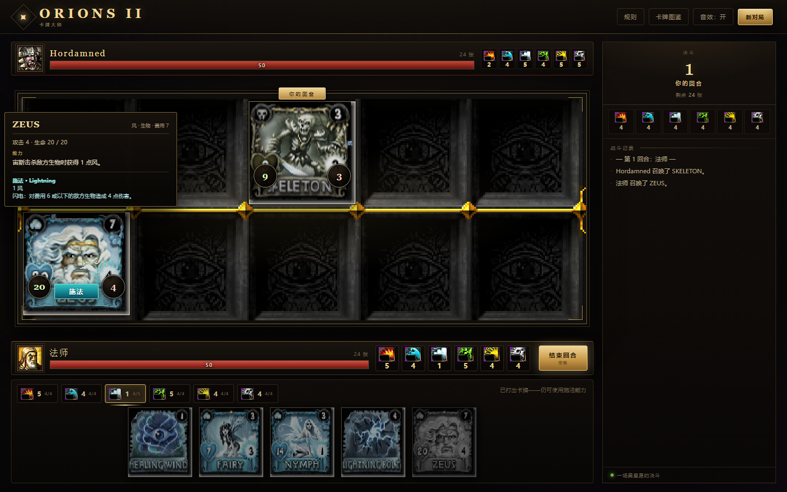
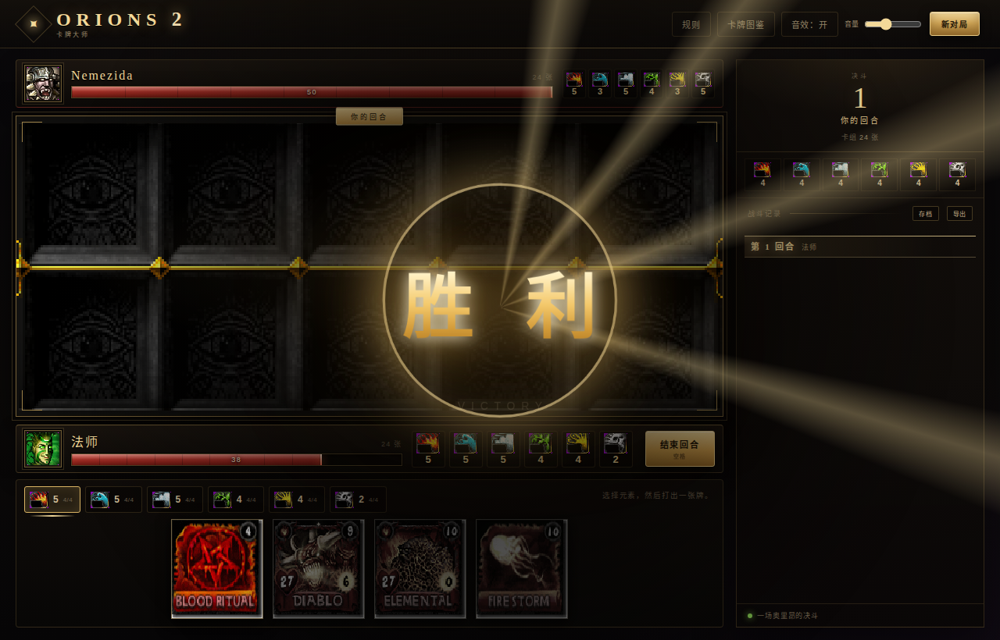
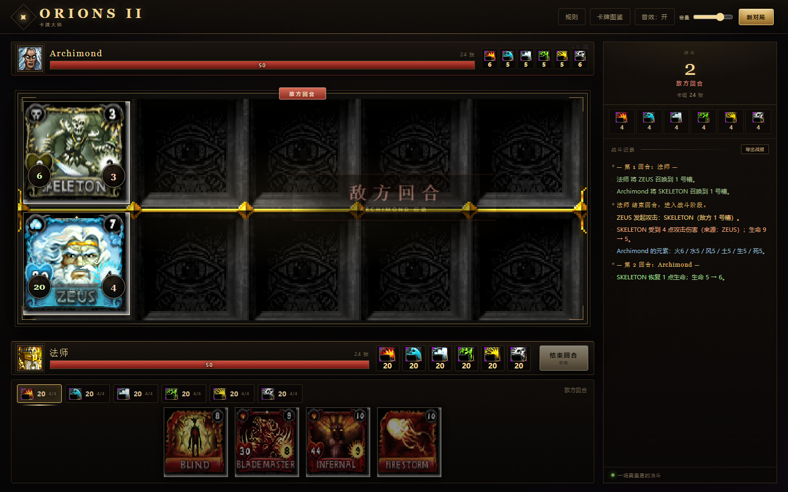
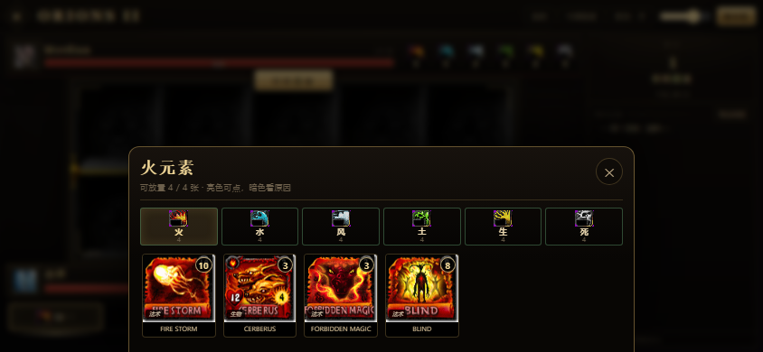

<div align="center">


# Orions 2 · The Deckmasters

**一款六元素卡牌对战游戏的网页复刻，附带安卓 WebView 打包工程。**

[](LICENSE)
[](#运行)
[](#游戏内容)
[](#ai-对手)
[](#贡献)

</div>

---

## 概览

《Orions 2: The Deckmasters》（MoreGames Entertainment / Chillingo，2010，iPhone）是一款经典的六元素卡牌对战游戏。本仓库是对其决斗模式的**非官方、非商业粉丝复刻**：完整重建 116 张卡牌、六系元素资源系统、CAST 能力与决斗流程，并提供网页版与安卓 APK 两种运行方式。

> ⚠️ 本项目仅用于本机运行、学习与怀旧。原游戏及卡图版权归 MoreGames Entertainment / Chillingo 与 [iPhone AC](https://iphoneac.com/orions2.html) 所有。



## 亮点

- 🃏 **116 张卡牌完整收录** — 费用、攻击、生命、被动、CAST 与目标、效果文本全部按原作数据重建，卡图使用原版 100×94 完整卡面。
- 🌊 **六系元素** — 火 / 水 / 风 / 土 / 生 / 死，每回合积累、按元素支付卡牌与 CAST 费用。
- 🎮 **多种模式** — 单人挑战三档 AI、双人同屏、局域网对战（WebRTC 直连 / 房间码服务器）、轮抽、自组卡组、9 种自定义挑战。
- 🤖 **会思考的 AI** — 三档难度，高阶 AI 会做一步前瞻模拟、优先斩杀、估算交换与法力曲线；修复模拟缺陷后对旧版胜率 **75.1%**。
- ⚔️ **打击感与特效** — 定向突进、命中回弹、冲击环、碎片飞散、震屏、血条残影；治疗金光、胜利金箔字，特效随棋格等比缩放。
- 📜 **详尽战报** — 逐条记录费用、目标、槽位、伤害来源、生命变化与状态；按回合渐变着色，可导出 JSON。
- 📱 **安卓离线 APK** — 系统 WebView 封装，强制横屏，单机与双人同屏完全离线可玩。

## 运行

### 网页版

最简单：直接用 Chrome / Edge / Firefox 打开 `orions2/index.html`（无需安装、无需联网）。

或启动静态服务器：

```bash
cd orions2
python -m http.server 8900
# 打开 http://127.0.0.1:8900
```

### 局域网对战

- **直连（推荐）**：双方连同一 Wi-Fi，复制粘贴 WebRTC 配对码即可，无需电脑、无需服务器。
- **房间码**：在任意设备运行 `node orions2/lan-server.js`，两台设备打开显示的 LAN 地址，输入 6 位房间码加入。

### 安卓 APK

按 [`android/README.md`](android/README.md) 的说明用 `tools/build-apk.sh` 一键构建，或直接使用发布版 APK。需要 Android SDK build-tools 34，不依赖 Gradle / Android Studio。

```bash
export ANDROID_SDK_ROOT=/path/to/android-sdk
cd android && tools/build-apk.sh
```

> 网页代码改动后，先同步进 APK 再构建：`rsync -a --delete ../orions2/{index.html,css,js,assets} assets/www/`。

## 游戏内容

<details>
<summary><b>规则摘要</b></summary>

- 目标：把对方 Deckmaster 的生命打到 0。**生命没有上限**。
- 开局每系随机 1–5 点（合计 25），之后每个自己的回合开始时每系 +1。
- 每回合只能打出 **一张卡**（生物进空槽，法术立即结算）。
- 有 CAST 的生物可每回合使用一次能力；回合结束时场上生物由左到右攻击正对面，对面为空则攻击敌方玩家。
- 当回合召唤的生物不能普通攻击（少数卡除外）；默认无反击，反伤是特定卡牌效果。

操作：点元素页签 → 点卡牌 → 点空槽或目标；点自己的生物查看卡面并使用 CAST。`Space` 结束回合，`Esc` 取消。平板/电脑上也可直接**拖动**手牌到放置位。

</details>

<details>
<summary><b>三种组牌方式</b></summary>

| 方式 | 说明 |
| --- | --- |
| 随机 | 双方各 24 张随机卡，每系 4 张，同一套卡组内不重复 |
| 自组 | 最多保存 6 套，每套 24 张、每系最多 5 张、同名卡限 1 张 |
| 轮抽 | 共享 116 张牌池，按 1-2-2-1 蛇形顺序各选 24 张，支持随机选/撤销/自动选完 |

</details>

<details>
<summary><b>9 种自定义挑战</b></summary>

冰与火、禁咒、魔力之池、诅咒之地、沙暴、守护者、乱流、猝死、压制——来自原版 Custom Duel 的变体规则。

</details>

### AI 对手

三档难度「学徒 / 法师 / 大法师」：会估算交换、优先击杀、选择伤害/治疗/增益目标、按法力曲线出牌，并在出牌前后安排 CAST。法师与大法师会对前 12 / 18 个候选动作做一步模拟（自身行动 + 战斗结算 + 对手快棋一手）后比较局面分数；AI 每回合**先判断能否斩杀**，够伤害就直接执行。

离线训练与 A/B 测试工具见 [`tools/AI-VALUE-NET.md`](orions2/tools/AI-VALUE-NET.md)。

## 截图

| 界面 | 效果 |
| --- | --- |
|  |  |
| 决斗主界面：5×2 槽位、元素栏、手牌与战报 | 战斗阶段：定向突进、命中特效与胜利金箔字 |
|  |  |
| 按回合渐变着色的逐条战报，可导出 JSON | 手机横屏：元素按钮弹出手牌选择器 |

## 项目结构

```
.
├── orions2/                  # 网页游戏本体（纯前端，无构建步骤）
│   ├── index.html            # 入口
│   ├── css/style.css         # 布局、战报渐变、全部特效动画
│   ├── js/                   # 引擎 / 卡牌数据 / 效果 / AI / 存档 / 局域网 / UI
│   ├── assets/               # 116 张卡图、UI 素材、音效、图标
│   ├── lan-server.js         # 可选房间码中继服务器
│   └── tools/                # AI 离线训练、A/B 测试、图标生成
├── android/                  # 安卓 WebView 打包工程
│   ├── AndroidManifest.xml   # 包名 / 版本 / 横屏 / 权限
│   ├── java/                 # MainActivity（含原生下载桥与文件选择器）
│   ├── res/                  # 图标、闪屏、主题
│   ├── tools/build-apk.sh    # 一键构建（aapt2 → javac → d8 → zipalign → apksigner）
│   └── assets/www/           # 网页副本（由 orions2/ 同步生成，不入库）
└── README.md / LICENSE
```

技术栈：原生 HTML / CSS / JavaScript（ES6），无框架、无构建；安卓端为 WebView + 少量 Java 原生桥；局域网对战使用 WebRTC DataChannel 与可选 Node.js 中继；AI 训练工具使用 Node.js。

详细文档：[网页版 README](orions2/README.md) · [安卓版 README](android/README.md)。

## 贡献

欢迎提交 Issue 反馈规则偏差或 bug（附上导出的战报 JSON 最有帮助），也欢迎 PR。规则实现以原作日文说明为准，数值修正请一并提供依据。

## 许可

本项目为非商业粉丝复刻，仅供学习与怀旧使用，详见 [LICENSE](LICENSE)。原游戏及卡图版权归 MoreGames Entertainment / Chillingo 与 iPhone AC 所有。

---

<div align="center">Made for the love of a classic card game. 🃏</div>
