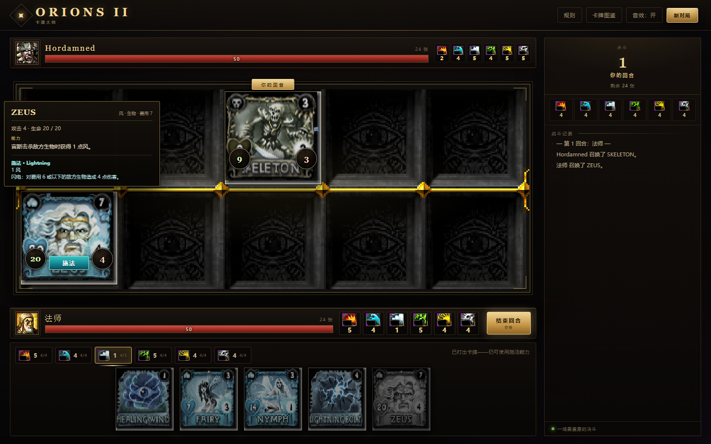
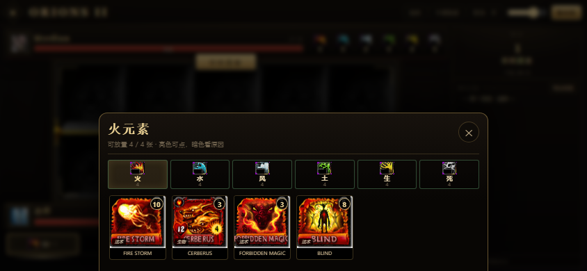
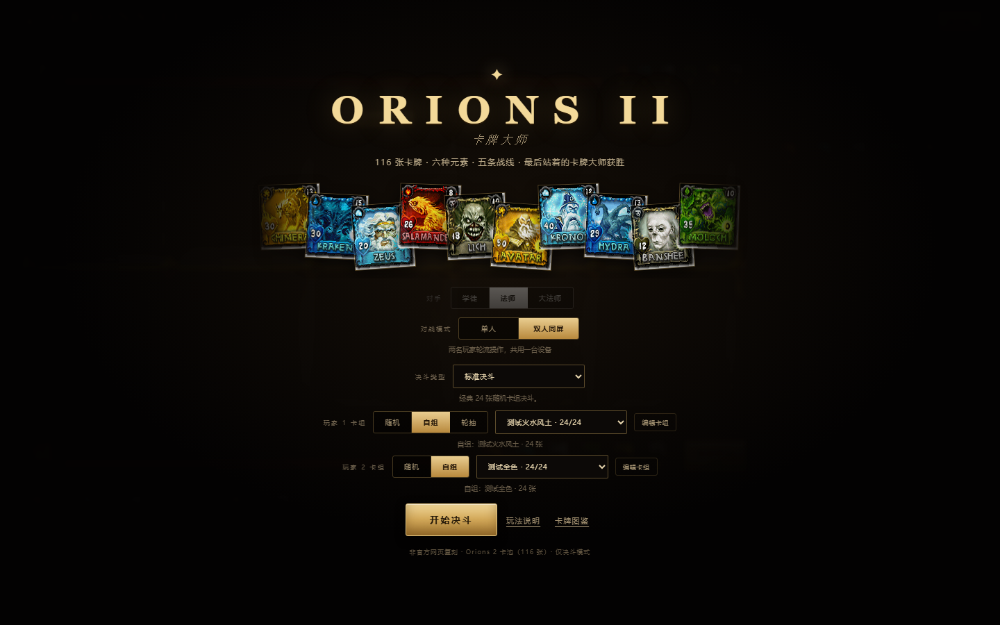
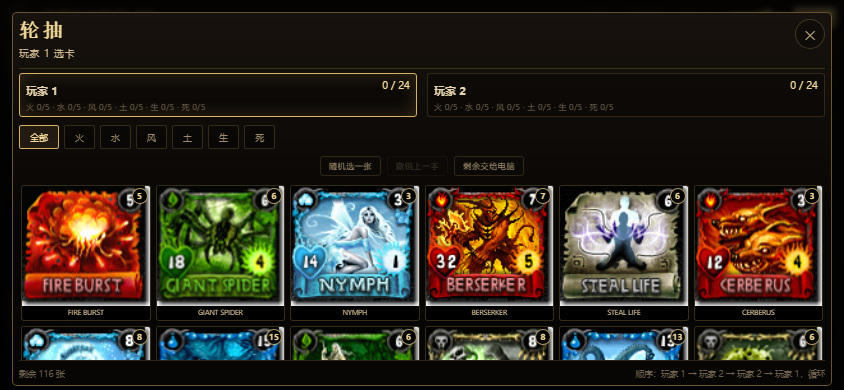
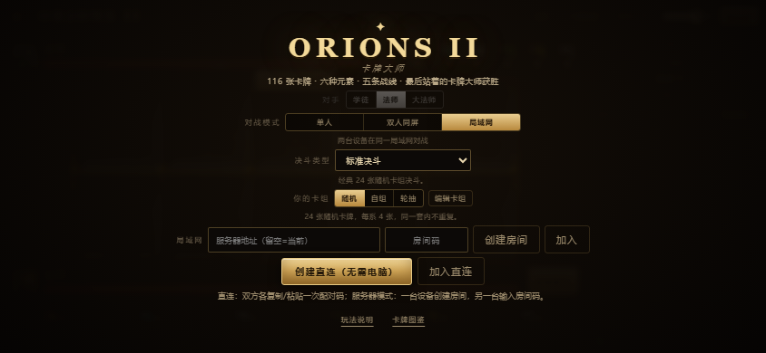
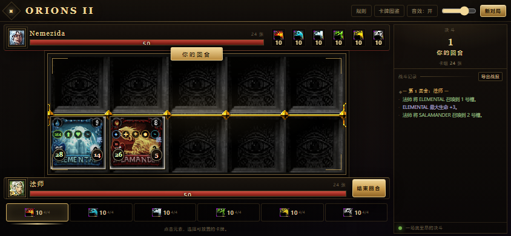
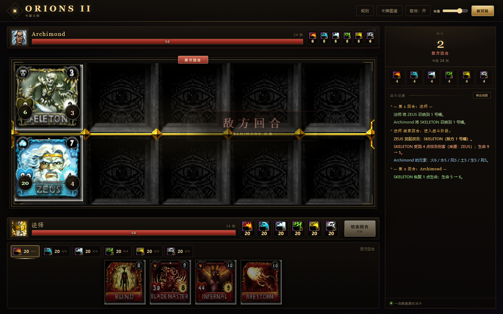

# Orions 2: The Deckmasters — 决斗（网页复刻）

这是 **Orions 2: The Deckmasters**（MoreGames Entertainment / Chillingo，2010，iPhone）的
网页版复刻，专注于卡牌决斗。卡牌数据、日文效果说明与全部卡图来自
[iPhone AC 的 Orions 2 攻略](https://iphoneac.com/orions2.html)：

- [水属性卡牌](https://iphoneac.com/orions2water.html)
- [火属性卡牌](https://iphoneac.com/orions2fire.html)
- [风属性卡牌](https://iphoneac.com/orions2air.html)
- [土属性卡牌](https://iphoneac.com/orions2earth.html)
- [生属性卡牌](https://iphoneac.com/orions2life.html)
- [死属性卡牌](https://iphoneac.com/orions2death.html)



手机版强制横屏：竖屏时会提示旋转；横屏后点击底部元素按钮，弹出该元素的全部手牌。
弹层顶部可直接点六个元素切换；亮色卡牌能放，暗色卡牌暂时不能放（点它显示原因）。



双人同屏时，玩家 1 和玩家 2 可以分别选择随机卡组或不同的自组卡组。



轮抽：双方共享全部 116 张卡池，按 1-2-2-1 的蛇形顺序轮流选卡。



## 运行

**最简单：** 双击 `index.html`，用 Chrome / Edge / Firefox 打开（无需安装）。

或者在本目录启动静态服务器：

```bash
python -m http.server 8900
# 打开 http://127.0.0.1:8900
```

当前机器上的局域网服务器：**http://127.0.0.1:8901/**（同时提供网页和房间中继）。

## 局域网对战

局域网有两种方式，**默认的直连模式不需要电脑、不需要服务器**。

### 方式 A：直连（推荐，无需电脑）

两台设备连接同一个 Wi-Fi / 局域网，各自打开游戏（网页版或 APK 均可），然后：

1. 一台选择“局域网” → “创建直连（无需电脑）”，会生成房主配对码。
2. 把房主配对码发给另一台设备（复制粘贴/聊天软件均可）。
3. 另一台选择“局域网” → “加入直连”，粘贴房主配对码，生成应答码。
4. 把应答码发回房主，房主粘贴后点“完成连接”。
5. 双方显示“直连已建立”，房主点“开始局域网对战”。

直连使用浏览器的 WebRTC DataChannel，点对点传输，不经过中心服务器；
双方既是对等端，也都可以发起连接。APK 同样支持直连。
配对码约 1KB，复制粘贴两次即可。

### 方式 B：服务器房间码（可选）

如果不想每次复制长配对码，可以在任意一台有 Node 的设备上运行：

```bash
cd orions2
node lan-server.js
# 或 npm start
```

终端会显示 LAN 地址，例如 `http://192.168.3.30:8901/`。两台设备打开该地址：

1. 一台“创建房间”，得到 6 位房间码。
2. 另一台输入房间码“加入”。
3. 房主选择卡组和决斗类型，点“开始局域网对战”。

房主是玩家 1（先手），客机是玩家 2，使用随机卡组；双方出牌、结束回合会实时同步。

APK 使用服务器模式时，在“服务器地址”填 `http://电脑IP:8901`；直连模式不需要填。



## 音量

顶栏有音量滑杆，手机横屏和桌面都可以拖动，设置会保存在浏览器里。
“音效：开/关”按钮可以快速静音。

## Android APK

交付文件根目录提供 **`Orions2.apk`**：

- 内嵌完整游戏，单机/双人同屏可离线运行，不需要浏览器。
- **强制横屏**（`sensorLandscape`），全屏沉浸式。
- 横屏布局：左侧棋盘与元素栏、右侧战斗日志。
- 支持触摸出牌、卡牌说明、双人同屏、轮抽、自组卡组、音量滑杆。
- 支持局域网直连（无需电脑/服务器，复制配对码）和可选服务器房间码模式。
- `minSdk 23`（Android 6+），`targetSdk 36`。
- 自签名调试 APK，安装时需要在系统里允许“未知来源”安装；不是应用商店包。

### 数据存放位置（对战记录在哪）

网页版与安卓版都用 WebView/浏览器的 `localStorage` 保存，键名一致：

| 键 | 内容 | 说明 |
|---|---|---|
| `orions2.records.v1` | 对战记录（逐回合日志 + AI 决策快照） | 最多 100 局，超限时先压缩日志再丢最旧的 |
| `orions2.aiLearned.v1` | 训练得到的 AI 权重 | 「重新训练」只重置记录，权重保留 |
| `orions2career_v1` | 生涯统计（总场次、胜负、连胜） | — |
| `orions2decks` | 自定义卡组 | — |
| `orions2volume`、`orions2lanServer` | 音量、局域网服务器地址 | — |

- **网页版**：跟着浏览器站点数据走。Chromium 系是 LevelDB
  （`Local Storage/leveldb/`），清「Cookie 和其他站点数据」会一起清掉。
- **安卓版**：存在应用私有目录
  `/data/data/com.orions2.game/app_webview/Default/Local Storage/leveldb/`，
  是 LevelDB 二进制，未 root 读不到，卸载应用即删除。
  所以不要指望用文件管理器找到「一个 json 文件」——记录直接导出即可。
- **导出**：安卓 1.0.4 起「对战记录 → 导出全部」会把文件写到 `下载/Orions2/`
  （旧版本没有原生下载桥，点了不会有文件，需先升级）；网页版走普通浏览器下载。
- **迁移/训练**：导出的 JSON 可以直接在另一台设备的「导入」里读回，
  也可以喂给 `tools/train-ai.js` 重新训练。

## 界面与视觉

- **名称与图标**：统一为 **Orions 2**。图标是自绘的星盘徽章——外圈刻度环、六芒星（对应六元素）、
  中心熔岩核心，纯几何绘制后 4x 超采样，任意尺寸都清晰。生成脚本 `tools/make-icon.py`，
  会同时写出各 dpi 的 `ic_launcher.png`、自适应图标前景与闪屏图。
- **战报分层**：`#log` 的每一行都带 `--age`（0 = 正在进行的回合），CSS 据此做渐变——
  当前回合有左侧金色光带与文字微光，上一回合降到 88%，更早的回合按距离逐级变暗，
  回合分隔条也同步变细变暗。
- **打击反馈**：
  - 攻击时卡片朝目标方向冲刺（`--tx/--ty` 由实际坐标算出，不再固定向上跳）；
  - 命中瞬间目标闪白回弹，落点生成十字星芒与冲击环；
  - 伤害数字加大加粗，≥8 点转金色爆炸字；玩家挨打时全屏短促震动，伤害越高震得越重；
  - 击杀时卡牌碎裂飞散、元素色闪光；
  - 血条带滞后残影（先掉一条亮红再追上），生命数字跳动，低于 30% 时红色脉动。
- 空槽压暗，棋盘用 inset 阴影做暗角，避免抢走生物的视觉焦点。

## 最近的规则修正

- **WEREWOLF / Blood Rage**：不再解除召唤疲劳。之前实现里多了一句 `c.sick = false`，狼人召唤
  当回合施放后就能立刻攻击，等于自带冲锋。现在 Blood Rage 只把本回合攻击力翻倍、本身不提供
  攻击：召唤当回合照常不能普通攻击，但翻倍后的数值对 UNDEAD SWARM 这类「按攻击力结算、
  不走普通攻击」的效果依然有效。
- **SEA MONSTER / Feed**：现在先让友方失去 6 点生命，再给 **Sea Monster 自己**永久 +2 攻击；
  之前错误地把 +2 加到了被吃的友方生物身上。
- **ELEMENTAL / TENTACLE / SOUL OF WINDS**：攻击力先按元素/数量取基础值，再继续叠加
  Empower、Salamander 光环和临时攻击，不再被固定值覆盖。
- **轮抽选卡**：保留滚动位置；新增随机选一张、撤销上一手、剩余自动选完。
- **卡面状态图标**：中毒、强化、魔法链接等状态改成卡面上的小图标。
- **SHADOW CLONE**：伤害仍由分身共同承担；治疗只作用于被治疗的分身，不联动治疗其他分身。
  分身之间的伤害传播加入防递归保护，避免多分身时重复放大。
- **DIABLO**：Fire Blessing 只排除 Diablo **自己**；如果场上同时有两个 Diablo，
  它们可以互相加 Fire Blessing。没有其他火系生物时按钮不可用。
- **BERSERKER**：生命 ≤4、或正对面是 Evil Sorcerer / Red Drake / Ethereal 这类完全免疫目标时，
  Berserk 按钮变灰，AI 不会空放。
- **FIRE WALL / ICE WALL**：没有攻击回合，攻击力固定为 0；不会被 Salamander 光环或任何攻击加成影响。
- **对战统计**：开始/结算界面可打开统计面板，记录总场次、单机/局域网胜负、胜率、累计回合、
  累计击杀、双人模式 P1/P2 胜场；按卡牌统计出场、召唤、法术、CAST 能力、总伤害、击杀、治疗，
  并列出使用最多、伤害最高、击杀最多、治疗最高的卡牌。
- **先后手**：开始界面可选择玩家 1 先手、玩家 2 先手或随机先后；随机签在开局确定后固定，
  局域网由房主抽签并同步给客机。单人模式若电脑先手，会先执行电脑回合。
- **元素缩放法术**：Chain Lightning、Steal Life、Fire Burst、Rejuvenation 都是
  **先按当前元素结算效果，再支付卡牌费用**；Raise Dead 是明确例外，按**施法后剩余死元素**召唤。
  卡牌详情和规则页已分别写出这两种顺序。
- **SLUG / 中毒**：Slug 不再能毒亡灵；中毒图标直接显示层数（如 `☠4`），战报会写
  “受到 N 点中毒伤害（毒 N 层）”。毒是按层数每回合扣血，4 层就是每回合 4 点。
- **RED DRAKE**：按施法元素识别火系法术，Fire Spikes / Fire Storm 等不再绕过火免疫；
  火系生物的攻击和 CAST 也免疫。
- **ETHEREAL**：免疫普通物理攻击和生物定向直伤；会承受范围法术、状态伤害、即死能力、
  Moloch 入场反伤，以及 Evil Sorcerer / Lich 的纯魔法攻击。9 血正好落在 Assassin /
  Giant Turtle 的即死线内。
- **EVIL SORCERER**：免疫魔法伤害、buff、debuff 和属性改变；攻击固定 5，不能被增益。
  普通物理攻击和 Elven Archer 的 physical 技能可伤害它，另一个 Evil Sorcerer 的能力可穿透。
- **UNDEAD SWARM**：只攻击正对面的生物；对面为空时不再直接打敌方玩家。
- **卡牌数据/显示**：ASSASSIN 文案费用、EARTHQUAKE 价格、APOSTATE/BLADE MASTER/SHADOW
  的 `castElement` 已修正；TENTACLE、ELEMENTAL、MOLOCH、SOUL OF WINDS、AVATAR 等
  变动数值在卡面/详情中显示为“变动”。
- **ASTRAL CLOUD**：对面 CAST 费用 +3；付不起时施法者受到 3 点伤害。
- **最大生命值**：单纯增加最大生命不再顺带增加当前生命。Shadow 的 Blend 会先 +10 最大生命，
  再单独治疗 10；满血目标也会实际增加 10 点当前生命。Restructure 的 +3 最大生命和 +6 治疗、
  Elemental Water 的 +3 最大生命、Lava Spider 的 +2 生命/+2 最大生命分别按卡面结算。
- **转变（Transform）**：Apostate 变 Banshee、Black Mage 的 Extract Soul 变 Skeleton
  使用独立的 transform 流程：不触发旧生物的死亡效果，也不触发新生物的召唤效果。
  所以 Banshee 不会额外打 8，Disperser 不会回元素，Imp 不会对敌方玩家造成死亡伤害。
- **完整战斗记录**：战报使用递增序号，不再因为记录上限/裁剪而停止追加；单局最多保留
  3000 条，右侧栏最多显示 1200 条。决斗结算画面新增“查看战斗记录”，可滚动查看整局战报。
- **伤害/治疗特效**：掉血、治疗、死亡动画和浮动数字停留时间加长，避免连续结算时看不清。
- **详细战报**：右侧战斗记录升级，包含费用、目标、槽位、伤害来源、生命变化、治疗、状态、
  移动、死亡来源和每回合元素量。
- **SALAMANDER**：光环只给**其他友方生物** +2 攻击；Salamander 自己仍是 3 攻，
  除非场上有第二个 Salamander 互相加成。法术伤害加成按 Salamander 数量叠加。
- **HEALING WIND**：Air 生物按 3 点计算，修正为“总生物数 + 2×Air 数”，不再多加一次。
- **ENCHANTER**：在回合开始治疗 **之前** 判断生命是否 ≤3，避免先被治疗到 4 点而拒绝死亡。
- **CHIMERA**：恢复原作流程：法术必须付得起全额，施法后返还一半费用；两个 Chimera 返还全额。
  因此 Wings of Wisdom 显示 5 费、7 费法术不会因为 Chimera 变成 3 费。
- **SOUL OF WINDS**：攻击力实时等于正对面生物的当前攻击；**任何来源**只要会造成伤害，
  Soul 都固定损失 20 生命（Blade Master 的 1 点反击也会变成 20），不再叠加原伤害。
- **SCARELING**：满血时卡面仍显示 **3 攻**；只有实际攻击结算时伤害翻倍。
- **GIANT SPIDER**：Spider Web 改为 **1 土**。
- **ZEUS**：Lightning 需要 **1 风**即可发动。
- **FAIRY**：Enslave Mind 按目标生物的实时攻击力让敌方拥有者受伤；对 Soul of Winds 也生效。
- **SEA MONSTER**：每场战斗阶段只攻击一次；攻击后向右移动，不会因为换槽在同回合重复攻击。
- **GUARDIAN / 范围伤害**：范围法术会先结算 Guardian 自己的那一份，再结算它替保护目标承受的伤害，
  因此 Guardian 在群体法术下会实际承受两份伤害。
- **LIGHTNING LORD**：Lightning 按使用前的 Air 元素结算，再扣除 3 Air。
- **BLESS**：不再重复叠加 +1 攻击；“不叠加”按字面生效。
- **TYTHON**：被眩晕/召唤失调时不能施放 Disperse，且不会先扣费。
- **LEVIATHAN**：必须在**施放前**拥有超过 6 点水，不能在 6 点时先扣费再失败。
- **WEREWOLF**：Blood Rage 现在按当前总攻击翻倍，而不是只加基础攻击；临时攻击在回合结束清除。
- **ENSLAVE**：按卡面要求需要 2 个空槽，否则目标直接死亡。
- **NECROMANCER / Dark Summon**：没有满足“有生物在其在场时死亡”时，按钮会禁用且不扣费。
- 全 116 张卡效果扫描与 AI 对局模拟均为 0 异常。

## 内容

- **全中文界面与卡牌说明**：菜单、规则、按钮、战斗记录、挑战、图鉴、组牌、结算全部中文化；
  116 张卡的能力与施法说明也全部翻译为中文，卡名保留英文便于和原版卡面/网站对照。
- **悬停自动说明**：鼠标在卡牌上停留约半秒会自动弹出中文说明，不需要右键；离开卡牌即消失。
  手机端长按卡牌也会显示。
- **手机版出牌流程**：手机/窄屏下底部固定六个元素按钮；点击元素会从底部弹出该元素的
  **全部手牌**，顶部六个元素按钮可直接切换；能放的卡牌亮色，不能放的暗色，点暗色卡牌会提示原因。
  点亮色卡牌后关闭弹层，再点高亮空槽放置，或点目标施放。
- **116 张卡牌**：费用、攻击、生命、被动、CAST 费用/目标、效果文本全部按网站数据重建；
  卡图使用网站提供的 100×94 完整卡面（含原版卡框、费用、生命与攻击）。
- **六系元素**：火 / 水 / 风 / 土 / 生 / 死。
- **完整决斗流程**：5×2 槽位、每回合 1 张卡、CAST 能力、召唤失误、正面战斗、
  无默认反击、生命无上限（治疗可以超过初始值）。
- **卡牌可重复使用**：决斗卡组 24 张且同名卡不重复；卡牌不会消耗，只要元素足够，
  同一张卡可以在不同回合反复打出。
- **攻击力动态结算**：Elemental、Tentacle、Soul of Winds 等“攻击力等于元素/数量”的生物，
  会在这部分基础攻击上继续叠加 Empower、Salamander 光环、临时攻击和咒术修正。
- **卡面状态图标**：中毒、眩晕、攻击/生命强化、受祝福、气盾、石肤、火盾、沉默、死亡狂怒、
  Elementalist 魔法链接、锈蚀、石化、无敌、保护、纯净之心等都会以彩色小图标显示在卡面上，
  悬停可看具体数值/原因。


- **结算时机**：法术、CAST、召唤效果即时结算；生物攻击在结束回合后的“战斗阶段”
  由左到右依次结算，界面会显示战斗阶段提示和逐次攻击特效。
- **生物卡上的“施法”按钮**：可施法的生物卡面会出现青色按钮；点击直接进入施法/选择目标，
  本回合用过后变灰（可重复施法的生物除外），下回合恢复。敌方/未轮到的一方显示为灰色不可用。
- **全行动特效**：召唤/放置有落位光环与粒子，攻击有突进与斩击，法术/施法有光束、元素闪光、
  目标和源头的环爆，掉血/治疗/死亡/中毒/增益/沉默/移动/元素增减/胜负都有对应的浮字、粒子或闪光。
- **详细战报**：右侧记录会写出每一手卡牌的费用和目标、召唤槽位、谁攻击谁、伤害来源、
  生命前后变化、治疗、状态获得、移动、死亡来源和每回合元素量；按类型着色并自动跟随最新一条。


- **战报导出**：战斗记录栏右上角有“导出战报”，可下载 JSON，包含双方卡组/场面/生命/元素、
  完整日志、逐条事件和结算异常记录，便于反馈 bug。
- **单人 / 双人同屏**：单人可挑战三档 AI；双人模式两名玩家轮流操作，
  轮到谁，下方生命、元素和手牌就切换为谁，并通过“请把设备交给玩家 2”过场保护手牌。
  双人开局时玩家 1/2 各有一行卡组设置，可以分别选择随机或不同的自组卡组。
- **局域网对战**：同一 Wi-Fi 下，一台设备创建房间，另一台输入 6 位房间码加入；
  房主先手，双方操作通过 `lan-server.js` 实时同步。
- **音量控制**：顶栏音量滑杆，手机横屏可用，设置保存在本地。
- **三种组牌方式**：
  - 随机：双方各 24 张随机卡（每系 4 张，同一套卡组内不重复；双方可能拿到相同卡）。
  - 自组：最多保存 6 套；每套 24 张、每系最多 5 张、**同一张卡只能放 1 张**，
    保存在浏览器 localStorage。
  - 轮抽：双方共享全部 116 张牌池，按 1-2-2-1 的蛇形顺序轮流选卡，各选 24 张；
    单人模式由电脑自动选，双人模式双方轮流点选。选卡列表会保持滚动位置；
    提供“随机选一张”“撤销上一手”“剩余交给电脑”三个快捷操作。
- **9 种自定义决斗挑战**（来自原版 Custom Duel）：
  - 冰与火：我方只能用火/死，敌方只能用水/风。
  - 禁咒：所有法术费用 ×2。
  - 魔力之池：每回合每系 +2。
  - 诅咒之地：每回合开始所有生物受 3 点魔法伤害。
  - 沙暴：每回合开始双方各受 5 点伤害。
  - 守护者：敌方开局场上有一个强力火系和一个强力水系生物。
  - 乱流：每回合随机获得共 6 点元素。
  - 猝死：我方 9 点生命，敌方 100 点。
  - 压制：我方开场有 Leviathan，敌方开场有两个 Knight。
- AI 对手（学徒 / 法师 / 大法师）：会估算交换、优先击杀、选择伤害/治疗/增益目标、
  按法力曲线出牌，并在出牌前后安排 CAST。**法师/大法师**会对前 12/18 个候选动作做一次模拟
  （自己的行动 + 战斗结算 + 对手快棋一手），再比较局面分数；大法师候选更多、更少失误。
  2026-11 修复了 `Game.clone()` 缺少 `cardStats` 导致**所有模拟静默失败**的问题——在此之前
  AI 实际只跑启发式评分。修复后与旧版对打 1500 局胜率 **75.1%**（95% CI 72.7–77.1%）。
  离线训练与 A/B 工具见 `tools/AI-VALUE-NET.md`。
- AI 每回合**先判断斩杀**：先算场上能直接打到对方英雄的伤害，再估算单张卡 + CAST 能补的
  直伤；只要够斩杀就立刻执行（场面已够时连卡都不打，直接结束回合），不够才进入正常出牌流程。
- 卡牌图鉴、规则页、战斗日志、伤害/死亡动画、胜负结算、手机布局。

## 规则摘要

- 目标：把对方 Deckmaster 的生命打到 0。**生命没有上限**。
- 开局每系随机 1–5 点（合计 25），之后每个自己的回合开始时每系 +1。
- 每回合只能打出 **一张卡**（生物进空槽，法术立即结算）；每张卡使用后消失。
- 有 CAST 的生物可以每回合使用一次 CAST（部分卡可重复）；费用按卡面/网站。
  也可以直接点卡面上的“施法”按钮，不需要先打开卡牌详情。
- 回合结束时，自己场上的生物攻击正对面的生物；对面为空则攻击敌方玩家。
  当回合召唤的生物不能攻击（Centaur 等有说明的除外）。
- 默认没有反击；Swordsman、Efreet、Ice Wall 等卡牌的反伤是特殊效果。

操作：点元素页签 → 点卡牌 → 点空槽或目标；点自己的生物查看卡面并使用 CAST。
`Space` 结束回合，`Esc` 取消。

## 与网站的对应关系

- 卡牌数量：网站列出 **116 张**（网站写“120 枚”，实际页面为 116 张），本作全部收录。
- 卡牌数值与效果以网站日文说明为准；英文文本为便于游戏内阅读的翻译/摘要。
- 网站说明的 **Custom Duel（Draft / User Deck / Challenge）** 均已实现；
  其中 Draft 使用全部 116 张共享牌池，双方按 1-2-2-1 的蛇形顺序轮流选卡，各选 24 张；
单人模式由 AI 自动完成自己的选卡。
- 网站提到的联机 DUEL、60 秒计时、战役/购买系统不在本作范围内。

## 最近修复

- 修复了部分卡牌把“运行时生物的攻击力”误写成 `creature.atk`（实际字段是 `baseAtk`/
  `atkBonus`/`tempAtk`）的问题。该错误会让 `undefined` 参与计算，最终把玩家生命写成 `NaN`；
  受影响的有 Undead Swarm、Fairy 的 Enslave Mind、Monk 的 True Prayer、Total Weakness、
  Python、strongest/weakest 选择等，现已统一改用 `attackValue`/`atkOf`。
- 引擎所有伤害、治疗、元素、攻击力、最大生命写入都增加了有限数检查；异常数值会被拦截、
  记入战报的 `errors`，并在侧栏提示导出，不会再显示 `NaN`。
- AI 的目标/放位评分也修正了同样的字段错误。

- 修复了两类「伤害反弹」无限递归：两个 BLADE MASTER 会互相触发溅射、两个 ELEMENTALIST 的
  魔法链接会来回转移伤害，触发后浏览器标签页会直接卡死。现在溅射不再二次触发、链接只转移一次，
  并给 `damageCreature` 加了递归深度上限。

- KRONOS 的 **Aging（衰老）** 改为对同一生物只生效一次：已衰老的生物不再进入可选目标，
  避免每回合把同一张卡的最大生命反复减半。
- **蛛网**改为绑定在生物身上（`flags.web`）而不只是眩晕计数：冰墙等换位效果不会让网脱落；
  同时修复「玩家被麻痹跳过回合时，顺手把所有生物的眩晕/蛛网扣掉一层」的问题。
- **SWORDSMAN 的反伤**只在它真的受到攻击伤害时触发，且不会伤害处于无敌（GIANT TURTLE 的
  Shell）或绝对防御状态的攻击者。

## 已知差异

- 少数日文描述存在歧义，按最接近原意的规则实现，例如：
  - Forbidden Magic 的“火属性生物数 ×3 伤害”按对敌方玩家结算；
  - Astral Cloud 的“CAST 费用 +3 / 支付不起受 3 伤害”实现了费用 +3，未实现
    “支付不起时改为受 3 伤害”这一分支；
  - Necromancer 的召唤前置条件按“本次决斗中曾有生物在 Necromancer 在场时死亡”判断。
- 这是非官方、非商业的粉丝复刻；原游戏与卡图版权归 MoreGames Entertainment /
  Chillingo 与 iPhone AC 所有。仅用于在本机运行、学习与怀旧。

## 备份

本次修改前的完整备份在 `backups/orions2-20261019-095245/` 和同名的 `.zip` 中。
更早的英文/双人版备份在 `backups/orions2-20261019-092303/`，两版都可以直接回滚。

## 经典版

原始 CAB（Orions: Legend of Wizards，148 张卡）的复刻仍保留在 `orions-classic/`
和 `orions-web.zip` 中，运行在 http://127.0.0.1:8899。
